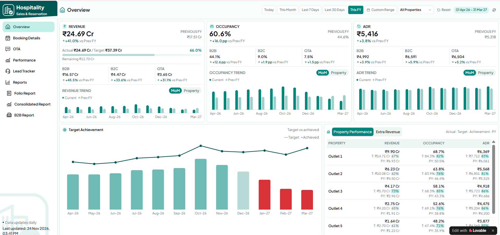
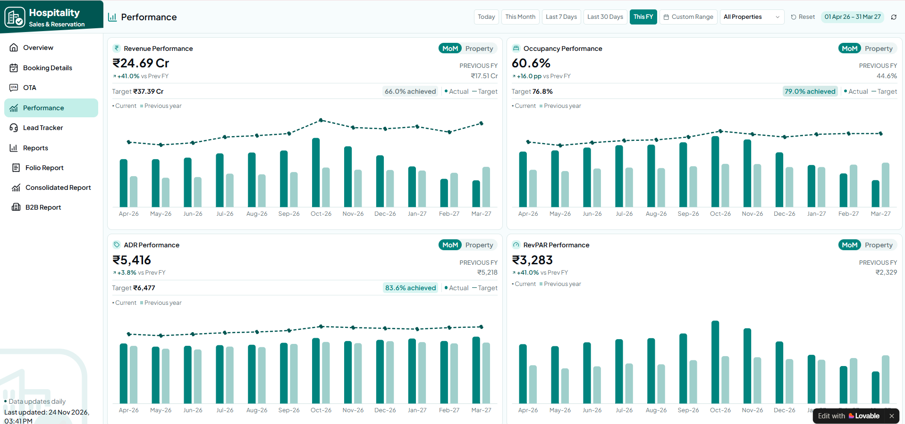
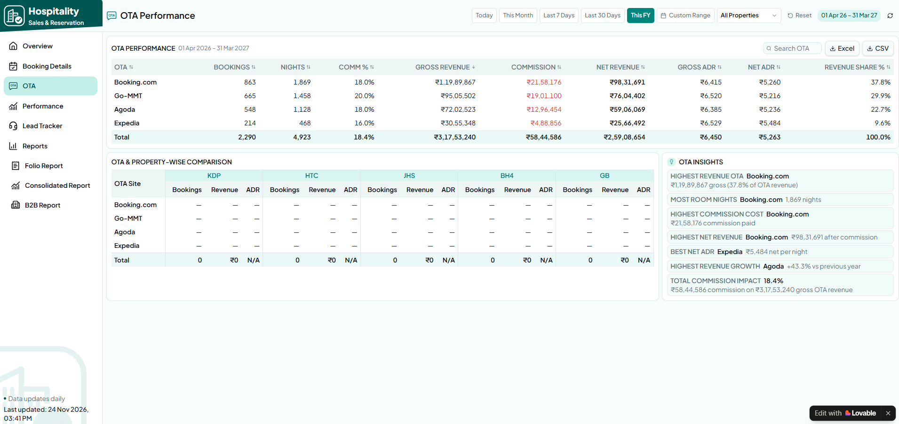

# Hospitality Sales & Revenue Intelligence Platform

### A centralized dashboard for sales, revenue, bookings, leads and OTA performance

**Interactive reporting that helps hospitality teams monitor commercial performance across properties.**

 

  

<a href="#executive-overview">Overview</a> &nbsp;|&nbsp;
<a href="#business-challenge">Challenge</a> &nbsp;|&nbsp;
<a href="#dashboard-solution">Solution</a> &nbsp;|&nbsp;
<a href="#dashboard-modules">Modules</a> &nbsp;|&nbsp;
<a href="#key-dashboard-capabilities">Capabilities</a> &nbsp;|&nbsp;
<a href="#my-role-and-contribution">My Role</a> &nbsp;|&nbsp;
<a href="#documentation">Documentation</a>

  

<!--
  LIVE DASHBOARD LINK (not yet verified)
  No live dashboard URL is recorded in this repository or its documentation.
  When you have the confirmed public URL for THIS project, replace PASTE-LIVE-DASHBOARD-URL-HERE
  below and remove the comment markers around the block.

-->

  

Overview: revenue, occupancy, ADR and RevPAR in one consolidated view

---

## Executive Overview

The **Hospitality Sales & Revenue Intelligence Platform** is a business intelligence dashboard that brings key commercial and operational metrics together, so hospitality teams can understand business performance across properties.

It uses Google BigQuery as its centralized data source and provides interactive dashboards, date and property filters, performance comparisons, lead tracking and downloadable reports.

| Audience | What they use it for |
| :-- | :-- |
| **Management** | A consolidated view of revenue, occupancy and commercial results |
| **Sales teams** | Lead pipeline activity, sources, stages and lost opportunities |
| **Revenue and property teams** | Property-level performance against monthly targets |
| **Finance and reporting teams** | Consolidated, folio and company reports with exports |

---

## Business Challenge

Hospitality reporting often depends on information held in separate places. This dashboard is designed to address challenges such as:

- **Fragmented sales and booking information**
- **Difficulty monitoring revenue performance** against targets
- **Limited visibility into lead conversion pipelines**
- **Difficulty comparing performance** across properties, periods and channels
- **A need for consolidated management reporting**

---

## Dashboard Solution

The platform brings the main hospitality reporting areas into one dashboard experience with shared filters, so a reviewer can move from the business-wide view to a property, a booking channel or a sales pipeline without losing the selected context.

| Overview | Performance | Booking Details | Lead Tracker | OTA | Reports |
| :-: | :-: | :-: | :-: | :-: | :-: |
| Business-wide snapshot | Property comparison | Booking analytics | Sales pipeline | Channel performance | Consolidated, folio, company |

---

## Dashboard Modules

### 1. Overview

A consolidated view of business performance: total revenue, room nights sold, occupancy, ADR and RevPAR, with comparison against a previous reporting period. It also includes revenue and occupancy trends, booking channel mix, property-wise performance and monthly target versus actual.

 

### 2. Performance

Property-level commercial performance: revenue, occupancy, ADR and RevPAR by property, with monthly target comparisons and target prorating for the selected date range. It helps identify which locations are performing above or below expectations.

 

### 3. Booking Details

Booking-level analysis: booking KPIs, guest-related and repeat-guest metrics, cancellations, room nights sold, sold inventory, website booking enquiries and booking channel breakdown. It helps users understand booking activity, cancellations, demand patterns and channel contribution.

 

### 4. Lead Tracker

Sales lead visibility across financial years, with lead date, source, property, format, sales stage, lead owner and lost-lead tracking. It helps sales teams monitor pipeline activity, review stage progression and understand lost opportunities.

 

### 5. OTA

A dedicated view of online travel agency channel performance, helping users understand the contribution of online travel channels to commercial activity.

 

### 6. Reports

A reporting section with three views: a **Consolidated Report** (daily property-level reporting grouped by financial-year quarter), a **Folio Report** (folio-level financial matrix) and a **Company Report** (company-level booking analysis). Supported reports can be exported to CSV and Excel.

---

## Key Dashboard Capabilities

| Capability | What it provides |
| :-- | :-- |
| **KPI monitoring** | Revenue, room nights, occupancy, ADR and RevPAR |
| **Target tracking** | Monthly targets, prorated to the selected date range |
| **Comparison analysis** | Comparison against a previous reporting period |
| **Booking analytics** | Bookings, cancellations, repeat guests and booking channels |
| **Lead pipeline visibility** | Leads by financial year, source, property, stage and owner |
| **Interactive filters** | Date range, financial year, property and comparison-period filters, kept in the page link |
| **Consolidated reports** | Consolidated, folio and company-level reporting |
| **Data export** | CSV and Excel export on supported report pages |

**Scope notes:** RevPAR targets are not shown because the supplied target data has none, and F&B revenue is not populated in the Folio Report because the supplied data source has no corresponding F&B sales table.

---

## Business Value

- **Faster reporting reviews** through one set of shared filters and consistent views
- **Better visibility** into sales performance across properties
- **More structured revenue monitoring** against monthly targets
- **Improved visibility** into the booking and lead pipelines
- **More informed management discussions** supported by consolidated and exportable reports

---

## Tools and Technologies

| Tool | Purpose in this project |
| :-- | :-- |
| **Google BigQuery** | Centralized analytical data source, accessed through a server-side, read-only integration |
| **TypeScript calculation modules** | Business calculations for overview, targets, leads and bookings, kept separate from data retrieval |
| **CSV and Excel export** | Downloadable reports from supported pages |

---

## My Role and Contribution

This is a **collaborative dashboard development project**. My involvement focused on:

- Understanding reporting requirements across sales, revenue, bookings and leads
- Organizing the dashboard into clear business modules
- Contributing to dashboard development and presentation of KPIs and reports
- Reviewing metrics and report outputs for business consistency

---

## Documentation

| Document | Description |
| :-- | :-- |
| [Dashboard Modules](docs/dashboard-modules.md) | Modules, features and filters |
| [Business Metrics](docs/business-metrics.md) | KPI and metric definitions |
| [Architecture](docs/architecture.md) | How the data and reporting layers fit together |
| [Data Dictionary](docs/data-dictionary.md) | Data fields and definitions |

---

## Data Privacy and Demonstration Note

This public portfolio repository is a demonstration. It uses demonstration or sanitized information and does not expose confidential business data, guest details, contact information, internal identifiers or private credentials. Database project, dataset and table identifiers are intentionally not published.

---

**Hospitality Sales & Revenue Intelligence Platform**

A hospitality business intelligence dashboard case study: collaborative dashboard development.

